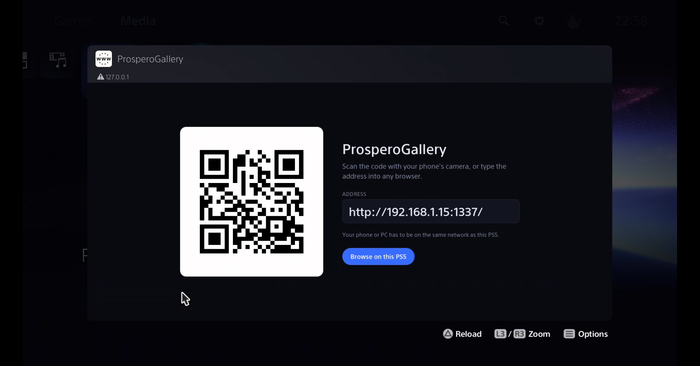
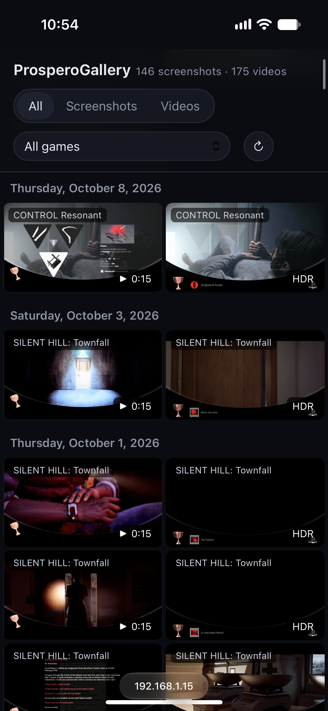

# ProsperoGallery

<p align="center">
  
</p>

<p align="center">
  A PlayStation 5 homebrew application that allows you to view your screenshots and clips on any device.
</p>

## Screenshots

 

## Setup

Please note that this has only been tested on a PS5 with firmware version 13.60. For any issues that might arise,
please open an issue on the GitHub repo and I will be more than happy to help.

### Important Beta Notice
The paths used to retrieve the screenshots and clips respectively are `user/av_contents/photo/NPXS40087/<game_id>` and 
`user/av_contents/video/NPXS40087/<game_id>`. `NPXS40087` **is assumed to be the same value for every console out there,**
and if things ever break I suspect this string to be the culprit. If screenshots don't show up, please open an issue
with a screenshot of you trying to access the `user/av_contents/video/<whatever>` path through a PS5 file explorer or
an FTP client.

### What you will need

- The latest payload (`prospero-gallery.elf`) from the
  [GitHub releases](https://github.com/AmineWallah/ProsperoGallery/releases) page.
- A jailbroken PS5 with an ELF loader.
- A phone, tablet or PC on the same local network as your PS5.
- **Optional but recommended**: [PS5 Payload Manager](https://github.com/itsPLK/ps5-payload-manager)

### 1. Load the payload

**With PS5 Payload Manager:** add `prospero-gallery.elf` to Payload Manager and launch it from there, like any
other payload.

**Manually:** send the payload to your ELF loader, which usually listens on port 9021. Replace `<PS5_IP>` with your
console's IP address, found on the PS5 under Settings > Network > Connection Status > View Connection Status.

```sh
nc -q0 <PS5_IP> 9021 < prospero-gallery.elf
```

If your version of `nc` does not accept `-q0`, use `-N` or `-w 1` in its place.

The console shows a "Gallery starting..." notification, followed by "Gallery running" with the gallery's address.
The payload keeps running until the console is turned off or restarted, so it needs to be loaded again after each
jailbreak. Sending it again while it is already running replaces the running copy.

### 2. Open the gallery on your PS5

The first time it runs, the payload adds a **ProsperoGallery** icon to the **Media** tab of the PS5 home screen
(you will see a "Gallery: icon added to the Media tab" notification). Open it, and the PS5 browser shows a QR code
and the gallery's address.

The icon stays on the home screen, but it only works while the payload is running.

### 3. Connect from your phone or PC

Either:

- **Scan the QR code** with your phone's camera, or
- **Type the address** into any browser. It looks like `http://<PS5_IP>:1337` and is also shown in the "Gallery
  running" notification.

Your phone or PC has to be on the same network as the PS5. You can also select **Browse on this PS5** to use the
gallery from the console itself.

### 4. Browse and download

- Your captures are grouped by day, newest first. Use the filters at the top to show only screenshots, only
  videos, or a single game.
- Select a capture to open it in full screen. Use the arrows, the arrow keys, or swipe on a phone to move between
  captures.
- Select **Download** to save it to your device.

Supported formats: JPG, PNG and JXR screenshots, MP4 and WebM videos.

HDR screenshots (`.jxr`) can't be displayed by browsers, so the payload converts them to JPG on the console. The
first time you open one, it takes a few seconds; after that it loads instantly. **Original HDR** downloads the
untouched `.jxr` file.

## Build from source

You need:

- The [PS5 Payload SDK](https://github.com/ps5-payload-dev/sdk), with the `PS5_PAYLOAD_SDK` environment variable
  pointing at it.
- `make` and `xxd` (`xxd` usually comes with Vim).

```sh
git clone https://github.com/AmineWallah/ProsperoGallery.git
cd ProsperoGallery

export PS5_PAYLOAD_SDK=/opt/ps5-payload-sdk   # fish: set -gx PS5_PAYLOAD_SDK /opt/ps5-payload-sdk

make ps5                          # builds prospero-gallery.elf
make send PS5_HOST=<PS5_IP>       # builds it and sends it to the ELF loader
```

### Testing on PC

Running `make` on its own builds a PC version of the server, which serves captures from
`./test_folder/user/av_contents` instead of the console:

```sh
make
./server
```

Then open `http://localhost:1337`. Copy some of your captures into `test_folder`, keeping the PS5's folder layout:

```
test_folder/user/av_contents/photo/NPXS40087/<TitleID>/<folder>/<capture>.jpg
test_folder/user/av_contents/video/NPXS40087/<TitleID>/<folder>/<capture>.mp4
```

Include the `.dat` file next to each capture, since that is where the game's name is read from.

## Credits

- [PS5 Payload SDK](https://github.com/ps5-payload-dev/sdk) by John Törnblom, used to build the payload.
- [NXGallery](https://github.com/iUltimateLP/NXGallery), the Nintendo Switch homebrew that inspired this project.
- [PS5 Payload Manager](https://github.com/itsPLK/ps5-payload-manager) by itsPLK and
  [ftpsrv](https://github.com/ps5-payload-dev/ftpsrv) by John Törnblom, whose approach is used to add the Media
  tab icon.
- [QR Code generator library](https://github.com/nayuki/QR-Code-generator) by Project Nayuki (MIT License).
- [jxrlib](https://github.com/4creators/jxrlib) by Microsoft, used to decode HDR screenshots (BSD 2-Clause License).
- [stb_image_write](https://github.com/nothings/stb) by Sean Barrett, used to save the converted JPGs
  (public domain / MIT License).

## License

ProsperoGallery is released under the GNU General Public License, version 3 or later. See [LICENSE](./LICENSE) for
the full text.

The third-party code in `third_party/` keeps its own license, found at the top of its files or in its folder.
